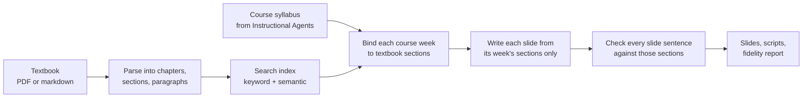

<div align="center">

# Textbook Grounding for Instructional Agents

[](https://www.python.org/downloads/)
[](LICENSE)
[](https://github.com/DaRL-GenAI/instructional_agents)

</div>

This branch extends [Instructional Agents](https://github.com/DaRL-GenAI/instructional_agents) so that a course is written **from an assigned textbook**, and every sentence on every slide is **checked against that textbook**. It is opt-in: pass `--use-textbook PATH` to turn it on. Without the flag, Instructional Agents runs exactly as before.

> **Paper:** *Citations Are Not Enough: Grounding AI-Generated Instructional Materials in Real Sources.* AI-Native Academia Workshop at NeurIPS 2026 (poster).
> The exact code behind the paper's results is tagged [`paper-neurips2026-evaluated`](https://github.com/shrey-Bish/instructional_agents/tree/paper-neurips2026-evaluated).

---

## Why

Instructional Agents generates a full course (syllabus, slides, speaker scripts and assessments) from a course name, using the language model's own knowledge. When a course is taught from a specific textbook, that is not enough: the slides should say what the book says, and an instructor should be able to check that they do.

A generated sentence can be plausible, or even correct, and still not be supported by the assigned book. Giving the model the book does not fix this on its own. A model with the complete chapter in its prompt still falls back on what it already knows, and loose retrieval pulls in passages from the wrong part of the book. This feature therefore controls **which evidence the model may use** at each step, and measures **how much of what it writes the book actually supports**.

## How it works



1. **Textbook parsing.** A PDF or markdown textbook becomes a chapter → section → paragraph structure. Figures are kept as images, and equation images are converted to LaTeX.
2. **Search index.** Paragraphs are split into ~512-token chunks and indexed for keyword search (BM25) and semantic search (OpenAI `text-embedding-3-large`), combined by reciprocal rank fusion. An optional cross-encoder reranker can refine the ranking.
3. **Chapter binding.** Before any slide is written, each course week is bound to a small set of textbook sections. The week's topic is expanded into several search queries, and the sections that rank highest across all of them are chosen. Weeks that match the book only weakly are still bound to their best sections, with the low confidence recorded.
4. **Grounded writing.** Each slide is written from excerpts retrieved only from its week's bound sections, under explicit grounding rules: teach in your own words, keep worked examples and notation, and do not add facts the excerpts do not contain. Textbook figures, captions and tables are carried onto the slides, and clean-up passes remove duplicate figures, empty slides and dangling figure references.
5. **Fidelity check.** Every slide sentence is checked against the full text of the week's bound sections. A sentence counts as supported only when the judge quotes supporting text that is then found, mechanically, in the source. Loosely quoted passes and first-time flags each get one more focused check. The result is written to `content_verification.json` for each chapter; the check never edits the slides.

## Results

From the paper, on a twelve-week data mining course. **Grounding Fidelity** is the share of generated slide sentences that the assigned textbook supports, judged by `gpt-4o` with mechanically verified quotes.

| | Three matched chapters | Twelve course weeks |
|---|---|---|
| Original generator, given the complete chapter text | 64.6% | 47.9% |
| **Textbook grounding (this branch)** | **77.5%** | **60.9%** |

- **Chapter binding matters most.** In ablations, removing the binding step drops fidelity below the original generator, even though retrieval is kept.
- **The judge is reliable.** It agrees with majority human labels on 90.8% of decidable claims.
- **Fidelity measures precision, not coverage.** It tells you how much of what was written the book supports, not how much of the book was taught.

## Quick start

```bash
git clone https://github.com/shrey-Bish/instructional_agents.git
cd instructional_agents
git checkout feature/textbook-grounding

pip install -e ".[grounding]"          # base install + grounding dependencies
export OPENAI_API_KEY=your_api_key_here

# Generate a course grounded in your textbook
python run.py "Data Mining" --catalog default_catalog --exp dm_grounded \
    --use-textbook path/to/textbook.pdf

# Score it, including the Grounding Fidelity %
python evaluate.py --exp dm_grounded --rigorous
```

The first run parses and embeds the textbook once; the result is cached in `.grounding_cache/` and reused afterwards. Compiling slides to PDF needs a LaTeX installation, and PowerPoint export needs Node.js with `pptxgenjs`; see the [Instructional Agents README](https://github.com/DaRL-GenAI/instructional_agents#readme) for those steps.

Textbooks are not included in this repository. Bring your own PDF or markdown file.

## Options

| Flag | What it does |
|---|---|
| `--use-textbook PATH` | Turns grounding on. `PATH` is a PDF, a markdown file, or a directory of either. |
| `--only-chapters N[,N]` | Generates only the listed chapters. With `--resume`, a listed chapter is regenerated even if it is already finished. |
| `--verifier-model MODEL` | Model for the fidelity check (default `gpt-4o`). |
| `--no-strict-verification` | Cheaper check against the writer's excerpts only, instead of the full bound sections. Scores are not comparable to strict runs. |
| `--vlm-extraction` | Uses a vision model on complex pages to extract figures, tables and equations. Slower and costs more. |
| `--model`, `--seed`, `--exp`, `--resume` | As in Instructional Agents (default generation model `gpt-4o-mini`). |

The API server accepts the same option as a `textbook_path` request field, and the web interface has a textbook file picker.

## What you get

For each chapter, in `exp/<name>/chapter_<N>/`:

| File | Contents |
|---|---|
| `slides.tex` | The slide deck (Beamer LaTeX), with textbook figures and captions |
| `script.md` | Speaker script for each slide |
| `assessment.md` | Questions and activities for the chapter |
| `content_verification.json` | The fidelity report: every slide sentence, marked supported (with the textbook quote that supports it) or flagged (with the reason), plus the bound textbook sections |

`evaluate.py --rigorous` adds up the per-chapter reports into one **Grounding Fidelity %** for the course, next to the standard rubric scores, under `eval/`.

## Where the code lives

| Path | Role |
|---|---|
| `src/textbook/` | Textbook parsing for PDF and markdown, including equation-to-LaTeX conversion |
| `src/grounding/knowledge_base.py` | Splitting the textbook into searchable chunks |
| `src/grounding/retriever.py` | Keyword + semantic search with rank fusion |
| `src/grounding/contract.py` | Chapter binding: which textbook sections each course week may use |
| `src/grounding/content_verifier.py` | The sentence-level fidelity check |
| `src/slides.py` | Grounded slide writing and clean-up passes (active only with a textbook) |
| `src/ADDIE.py`, `run.py`, `api_server.py` | Wiring and command-line options |
| `evaluate.py` | Rubric scoring and the course-level Grounding Fidelity % |
| `tests/` | Unit tests for every grounding component |

## Known limitations

- **Broad or survey weeks bind weakly.** An introduction or review week may not match one part of the book well, and its fidelity is usually lower.
- **Fidelity is a precision measure.** A deck can score high while covering only part of a chapter.
- **The judge is a language model.** Quotes are verified mechanically, but supported/unsupported verdicts can still be wrong in individual cases.

## Everything else

All other Instructional Agents features (the web interface, Docker deployment, API server, catalog and copilot modes, and LaTeX-to-PowerPoint conversion) work as in the original project. See the [Instructional Agents README](https://github.com/DaRL-GenAI/instructional_agents#readme).

## Citation

Please cite Instructional Agents, which this work builds on:

```
@misc{yao2025instructionalagentsllmagents,
  title={Instructional Agents: Reducing Teaching Faculty Workload through Multi-Agent Instructional Design},
  author={Yao, Huaiyuan and Xu, Wanpeng and Turnau, Justin and Kellam, Nadia and Wei, Hua},
  year={2025},
  eprint={2508.19611},
  archivePrefix={arXiv},
  primaryClass={cs.AI},
  url={https://arxiv.org/abs/2508.19611},
}
```

And the textbook-grounding paper: *Citations Are Not Enough: Grounding AI-Generated Instructional Materials in Real Sources*, AI-Native Academia Workshop at NeurIPS 2026. A BibTeX entry will be added with the camera-ready version.

## License

MIT License, as in Instructional Agents.
