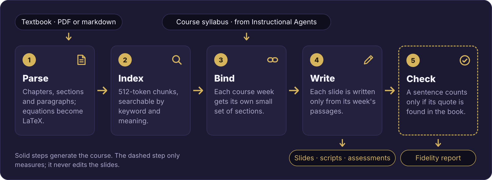
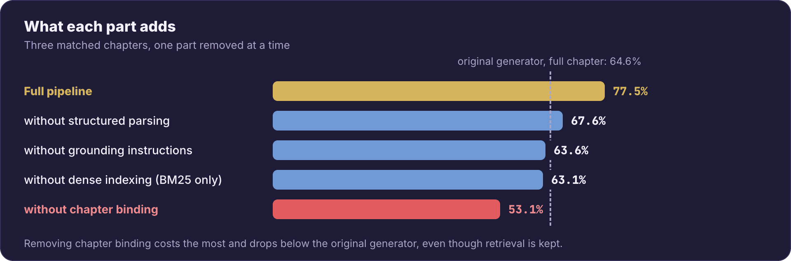
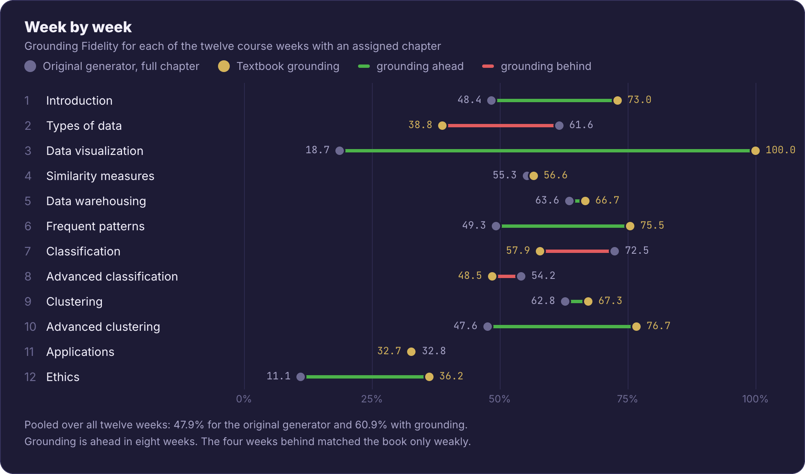

<div align="center">

# Textbook Grounding for Instructional Agents

[](https://www.python.org/downloads/)
[](LICENSE)
[](https://github.com/DaRL-GenAI/instructional_agents)
[](#citation)

**Course slides written from your textbook, with every sentence checked against it.**


</div>

This branch adds an opt-in textbook mode to [Instructional Agents](https://github.com/DaRL-GenAI/instructional_agents). Pass `--use-textbook PATH` and every slide is written from passages of your book. Without the flag, Instructional Agents runs exactly as before.

> **Paper:** *Citations Are Not Enough: Grounding AI-Generated Instructional Materials in Real Sources.* AI-Native Academia Workshop at NeurIPS 2026 (poster). The code as evaluated in the paper is tagged [`paper-neurips2026-evaluated`](https://github.com/shrey-Bish/instructional_agents/tree/paper-neurips2026-evaluated).

## Why

- Instructional Agents writes a whole course from the language model's memory.
- A course taught from a textbook should say what that book says, and an instructor should be able to check it.
- Putting the whole chapter in the prompt is not enough: much of what the model writes is still not in the book. Choosing which passages it sees works better.

## How it works



<details>
<summary><b>More detail on each step</b></summary>

1. **Parse.** A PDF or markdown textbook becomes a chapter, section and paragraph structure. Figures are kept as images, and images of equations are converted to LaTeX.
2. **Index.** Paragraphs are split into ~512-token chunks and indexed for keyword search (BM25) and semantic search (OpenAI `text-embedding-3-large`). The two rankings are combined by reciprocal rank fusion. An optional cross-encoder reranker can refine them.
3. **Bind.** Before any slide is written, each course week is bound to a small set of textbook sections. The week's topic is expanded into several search queries, and the sections that rank highest across them are chosen. A week that matches the book only weakly is still bound to its best sections, with the low confidence recorded.
4. **Write.** Each slide is written from passages retrieved only from its week's sections. The writer is told to teach in its own words, keep worked examples and notation, and add nothing the passages do not support. Textbook figures, captions and tables are carried onto the slides. Clean-up passes remove duplicate figures, empty slides and dangling figure references.
5. **Check.** Every slide sentence is judged against the full text of the week's sections. It counts as supported only when the judge quotes supporting text that is then found, word for word, in the book. Loosely quoted passes and first-time flags each get one more focused check. The result goes to `content_verification.json` for each chapter. The check never edits the slides.

</details>

## Results




- The automated judge agrees with majority human labels on 90.8% of decidable claims.
- Fidelity measures precision, not coverage. It shows how much of what was written the book supports, not how much of the book was taught.

<details>
<summary><b>Week-by-week results</b></summary>



</details>

## Quick start

```bash
git clone https://github.com/shrey-Bish/instructional_agents.git
cd instructional_agents
git checkout feature/textbook-grounding

pip install -e ".[grounding]"
export OPENAI_API_KEY=your_api_key_here

# Generate a course from your textbook
python run.py "Data Mining" --catalog default_catalog --exp dm_grounded \
    --use-textbook path/to/textbook.pdf

# Score it, including the course-level Grounding Fidelity %
python evaluate.py --exp dm_grounded --rigorous
```

Bring your own PDF or markdown textbook. None ships with this repository. The first run parses and embeds the book once and caches it in `.grounding_cache/`. PDF compilation and PowerPoint export are set up as in the [Instructional Agents README](https://github.com/DaRL-GenAI/instructional_agents#readme).

<details>
<summary><b>All options</b></summary>

| Flag | What it does |
|---|---|
| `--use-textbook PATH` | Turns grounding on. `PATH` is a PDF, a markdown file, or a directory of either. |
| `--only-chapters N[,N]` | Generates only the listed chapters. With `--resume`, a listed chapter is regenerated even if it is already finished. |
| `--verifier-model MODEL` | Model for the fidelity check (default `gpt-4o`). |
| `--no-strict-verification` | Cheaper check against the writer's excerpts only, instead of the full sections. Scores are not comparable to strict runs. |
| `--vlm-extraction` | Uses a vision model on complex pages to extract figures, tables and equations. Slower and costs more. |
| `--model`, `--seed`, `--exp`, `--resume` | As in Instructional Agents (default generation model `gpt-4o-mini`). |

The API server takes the same option as a `textbook_path` request field, and the web interface has a textbook file picker.

</details>

## What you get

```text
exp/<name>/chapter_<N>/
├── slides.tex                  # Beamer deck, with textbook figures and captions
├── script.md                   # speaker script for each slide
├── assessment.md               # questions and activities
└── content_verification.json   # each sentence: supported (with its quote) or flagged
```

`evaluate.py --rigorous` adds up the per-chapter reports into one Grounding Fidelity % for the course, next to the standard rubric scores, under `eval/`.

<details>
<summary><b>Where the code lives</b></summary>

| Path | Role |
|---|---|
| `src/textbook/` | Textbook parsing for PDF and markdown, including equation-to-LaTeX conversion |
| `src/grounding/knowledge_base.py` | Splitting the textbook into searchable chunks |
| `src/grounding/retriever.py` | Keyword and semantic search with rank fusion |
| `src/grounding/contract.py` | Chapter binding: which textbook sections each course week may use |
| `src/grounding/content_verifier.py` | The sentence-level fidelity check |
| `src/slides.py` | Grounded slide writing and clean-up passes, active only with a textbook |
| `src/ADDIE.py`, `run.py`, `api_server.py` | Wiring and command-line options |
| `evaluate.py` | Rubric scoring and the course-level Grounding Fidelity % |
| `tests/` | Unit tests for every grounding component |

</details>

## Known limitations

- Broad survey weeks, such as an introduction or a review, match the book weakly and usually score lower.
- A deck can score high on fidelity while covering only part of a chapter.
- The judge is a language model. Its quotes are checked mechanically, but individual verdicts can still be wrong.

## Everything else

The web interface, Docker deployment, API server, catalog and copilot modes, and LaTeX-to-PowerPoint conversion work as in the original project. See the [Instructional Agents README](https://github.com/DaRL-GenAI/instructional_agents#readme).

## Citation

Please cite Instructional Agents, which this work builds on:

```bibtex
@misc{yao2025instructionalagentsllmagents,
  title={Instructional Agents: Reducing Teaching Faculty Workload through Multi-Agent Instructional Design},
  author={Yao, Huaiyuan and Xu, Wanpeng and Turnau, Justin and Kellam, Nadia and Wei, Hua},
  year={2025},
  eprint={2508.19611},
  archivePrefix={arXiv},
  primaryClass={cs.AI},
  url={https://arxiv.org/abs/2508.19611},
}
```

And the textbook-grounding paper: *Citations Are Not Enough: Grounding AI-Generated Instructional Materials in Real Sources*, AI-Native Academia Workshop at NeurIPS 2026. A BibTeX entry will be added with the camera-ready version.

## License

MIT License, as in Instructional Agents.
